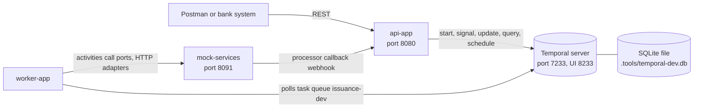
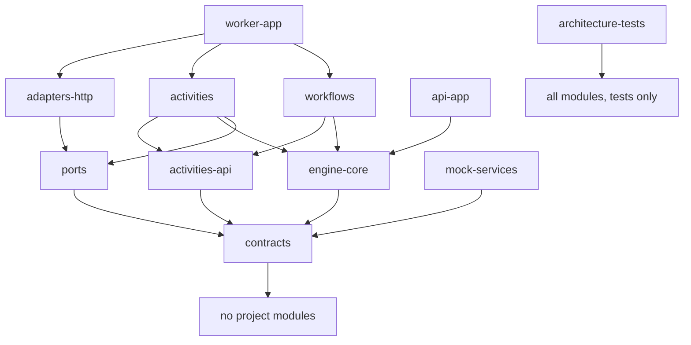
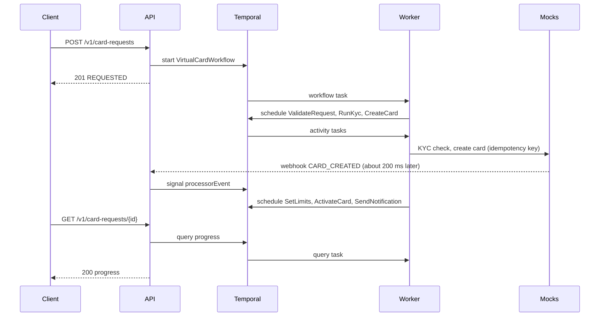

# Architecture and code flow

How the card issuance prototype is built, what it can do, where its data lives, how a request moves through it, and what every file in the repository is for. It covers Milestones 1 to 3. Design decisions and their reasons are in [design-amendments.md](design-amendments.md). How to set up and run the project is in the [README](../README.md).

Contents:

1. [The big picture](#1-the-big-picture)
2. [Features in the current code](#2-features-in-the-current-code)
3. [Module layout and dependency rules](#3-module-layout-and-dependency-rules)
4. [Where data is stored](#4-where-data-is-stored)
5. [Where each Temporal piece is defined, registered and called](#5-where-each-temporal-piece-is-defined-registered-and-called)
6. [Code flow: issuing a virtual card](#6-code-flow-issuing-a-virtual-card)
7. [Code flow: signals, timers and updates](#7-code-flow-signals-timers-and-updates)
8. [Heartbeats](#8-heartbeats)
9. [Codebase walkthrough, file by file](#9-codebase-walkthrough-file-by-file)
10. [Determinism: why workflow code looks the way it does](#10-determinism-why-workflow-code-looks-the-way-it-does)
11. [Edge cases and how they are handled](#11-edge-cases-and-how-they-are-handled)
12. [Tests](#12-tests)
13. [Future implementation](#13-future-implementation)

## 1. The big picture

There are four processes:

| Process | What it does | Main entry point |
|---|---|---|
| Temporal dev server | Stores workflow history in SQLite, runs timers and schedules, hands out tasks, serves the Web UI. It never runs our code. | [infra/scripts/start-temporal.cmd](../infra/scripts/start-temporal.cmd) |
| `api-app` | The only front door. Validates input, starts workflows by name, forwards callbacks as signals, decisions as updates, and reads progress with queries. | [ApiApplication.java](../api-app/src/main/java/com/occlet/issuance/api/ApiApplication.java) |
| `worker-app` | Runs workflow and activity code. It pulls work from Temporal, so Temporal never calls it. It has no HTTP port. | [WorkerApplication.java](../worker-app/src/main/java/com/occlet/issuance/worker/WorkerApplication.java) |
| `mock-services` | Fake KYC, card processor and notification service, with failure injection, an admin API and real callbacks. | [MockServicesApplication.java](../mock-services/src/main/java/com/occlet/issuance/mock/MockServicesApplication.java) |

Three loops run through the system:

1. **Requests:** API to Temporal. The API starts a workflow, and Temporal records it.
2. **Work:** the worker asks Temporal for tasks, runs workflow code, and runs activities that call the mocks.
3. **Callbacks:** the mock processor calls the API webhook, and the API turns it into a signal on the waiting workflow.

## 2. Features in the current code

### Milestone 1: foundation

| Feature | Where |
|---|---|
| Multi-module Maven build on Java 25 and Spring Boot 4.2.0, with the Temporal Java SDK 1.41.1 | [pom.xml](../pom.xml) |
| Temporal dev server with a persistent SQLite file and five custom search attributes | [start-temporal.cmd](../infra/scripts/start-temporal.cmd) |
| Sample `HelloWorkflow` with one activity, started by type name from `POST /v1/hello` | [HelloWorkflowImpl.java](../workflows/src/main/java/com/occlet/issuance/workflows/HelloWorkflowImpl.java), [HelloController.java](../api-app/src/main/java/com/occlet/issuance/api/HelloController.java) |
| Separate API and worker processes. The API never imports workflow or activity classes. | [ArchitectureTest.java](../architecture-tests/src/test/java/com/occlet/issuance/architecture/ArchitectureTest.java) |
| Architecture rules that fail the build on banned dependencies and non-deterministic calls | `ArchitectureTest` |
| Card number scanner (Luhn-checked) that proves no card number reaches workflow history | [CardNumberScanner.java](../architecture-tests/src/test/java/com/occlet/issuance/architecture/CardNumberScanner.java) |
| Replay tests that rerun recorded histories against the current code | [WorkflowHistoryTest.java](../architecture-tests/src/test/java/com/occlet/issuance/architecture/WorkflowHistoryTest.java) |

### Milestone 2: virtual card issuance

| Feature | Where |
|---|---|
| `VirtualCardWorkflow`: validate, KYC, create card, set limits, activate, notify | [VirtualCardWorkflowImpl.java](../workflows/src/main/java/com/occlet/issuance/workflows/VirtualCardWorkflowImpl.java) |
| Reusable step engine: progress records, card status, search attributes, saga | [StepRunner.java](../engine-core/src/main/java/com/occlet/issuance/engine/StepRunner.java) |
| Five named retry profiles, tuned in one place | [RetryProfile.java](../engine-core/src/main/java/com/occlet/issuance/engine/RetryProfile.java) |
| Idempotency keys `tenant:request:step`, sent on every external write, so retries never duplicate work | [IdempotencyKeys.java](../activities/src/main/java/com/occlet/issuance/activities/IdempotencyKeys.java) |
| Failure classes: business (not retried), technical (retried), ambiguous (retried with the same key) | [PortException.java](../ports/src/main/java/com/occlet/issuance/ports/PortException.java), [FailureMapper.java](../activities/src/main/java/com/occlet/issuance/activities/FailureMapper.java) |
| Saga compensation in reverse order, registered before each call (amendment A3) | `StepRunner.compensateWith` |
| Best-effort notification that never undoes the card | `StepRunner.runBestEffort` |
| `progress` query that shows every step's state, timing and last error | `VirtualCardWorkflow.progress` |
| Search attributes `TenantId`, `CardId`, `CardType`, `CardStatus`, `RequestId`, kept up to date | [CardSearchAttributes.java](../engine-core/src/main/java/com/occlet/issuance/engine/CardSearchAttributes.java) |
| Request idempotency: the same `Idempotency-Key` returns the existing request | `CardRequestController.create` |
| Tenant isolation: tenant registry, tenant in every workflow ID, other tenants get `404` | [IssuanceProperties.java](../api-app/src/main/java/com/occlet/issuance/api/IssuanceProperties.java) |
| Refusal of card-number-like input before it can enter history | [ApiResponses.java](../api-app/src/main/java/com/occlet/issuance/api/ApiResponses.java) |
| Mock KYC, processor and notification services with failure injection and call counters | [mock-services](../mock-services/src/main/java/com/occlet/issuance/mock) |
| One-command scenario runner on separate ports | [run-scenarios.ps1](../infra/scripts/run-scenarios.ps1) |

### Milestone 3: every Temporal interaction pattern

| Feature | Temporal pattern | Where |
|---|---|---|
| Processor confirmation callback through a webhook | Signal | [WebhookController.java](../api-app/src/main/java/com/occlet/issuance/api/WebhookController.java), `VirtualCardWorkflowImpl.processorEvent` |
| Confirmation wait raced against a timeout | Durable timer | `StepRunner.waitFor` |
| Parking for an operator when KYC needs review, the confirmation is late, or retries run out | `Workflow.await` on state | `StepRunner.park`, `callOrPark` |
| Operator decision: approve, reject, retry or cancel, checked against the kind of review | Update with validator | `review` update, `StepRunner.validateDecision` |
| Cancellation, refused after the card is active (amendment A7) | Update with validator | `cancel` update, `StepRunner.validateCancel` |
| Safe retry of an operator call | Update ID from `Idempotency-Key` | [WorkflowCalls.java](../api-app/src/main/java/com/occlet/issuance/api/WorkflowCalls.java) |
| Reissue of a lost, stolen, damaged or expired card: block the old card, issue a replacement, link them | Child workflow | [ReissueWorkflowImpl.java](../workflows/src/main/java/com/occlet/issuance/workflows/ReissueWorkflowImpl.java) |
| Reconciliation of processor cards against platform records | Long-running activity with heartbeats and resume | [ReconciliationActivitiesImpl.java](../activities/src/main/java/com/occlet/issuance/activities/ReconciliationActivitiesImpl.java) |
| Nightly reconciliation per tenant at 02:00 UTC, with skipped overlaps and an on-demand trigger | Schedule | [ReconciliationSchedules.java](../api-app/src/main/java/com/occlet/issuance/api/ReconciliationSchedules.java) |
| Platform card records read from Temporal visibility | List workflows by search attributes | [TemporalPlatformRecords.java](../worker-app/src/main/java/com/occlet/issuance/worker/TemporalPlatformRecords.java) |
| Mock callbacks in `NORMAL`, `DELAY`, `DUPLICATE` or `NEVER` mode, with delivery retries | | [CallbackSender.java](../mock-services/src/main/java/com/occlet/issuance/mock/CallbackSender.java) |
| Quick `503` instead of a hung request when no worker answers | Query and update deadlines | `WorkflowCalls` |
| Postman collection of 108 requests with checks and polling | | [postman](../postman) |
| Start, stop and restart scripts for all four services | | [infra/scripts](../infra/scripts) |

Not built yet: physical and agentic cards, the React UI, durable idempotency storage, and production hardening. See [section 13](#13-future-implementation).

## 3. Module layout and dependency rules

| Module | Holds | Temporal role |
|---|---|---|
| `contracts` | Records and enums shared by everyone, and name constants such as `WorkflowTypes`, `StepNames` and `ErrorTypes` | Names of workflows, signals, updates and queries |
| `ports` | Plain Java interfaces for external systems, plus the three failure classes in `PortException` | None. Free of Temporal and Spring |
| `engine-core` | `StepRunner`, `RetryProfile` and `CardSearchAttributes` | Reusable helpers that run inside workflow code |
| `activities-api` | Activity interfaces and their command records | Activity definitions the workflows compile against |
| `activities` | Activity implementations | Code run by the worker when Temporal hands it an activity task |
| `workflows` | Workflow interfaces and implementations | Workflow definitions |
| `adapters-http` | HTTP implementations of the ports | None |
| `worker-app` | Spring wiring that registers workflows and activities | Starts the worker |
| `api-app` | REST controllers | Temporal client: starts, signals, updates, queries, schedules |
| `mock-services` | Mock external systems | None |
| `architecture-tests` | Architecture rules, card number scanning and replay tests | Replays histories |

`activities-api` is separate from `activities` (amendment A8). That way, workflow code can only see activity interfaces, never their implementations or the HTTP code behind them. [ArchitectureTest.java](../architecture-tests/src/test/java/com/occlet/issuance/architecture/ArchitectureTest.java) fails the build if a module breaks these rules, or if workflow or engine code uses Spring, HTTP, files, threads, the wall clock or randomness.

## 4. Where data is stored

There is no application database yet. Data lives in two places: Temporal's SQLite file, which survives restarts, and the mock processor's memory, which doesn't. The API and worker keep nothing of their own.

### 4.1 Temporal's SQLite file: `.tools\temporal-dev.db`

[start-temporal.cmd](../infra/scripts/start-temporal.cmd) runs `temporal server start-dev --db-filename .tools\temporal-dev.db`. The dev server keeps everything in that one file: namespaces, workflow state and history, timers, schedules, task queues and the visibility index. The file is ignored by git (`*.db` in [.gitignore](../.gitignore)).

**What the platform stores in it:**

| Data | How it gets there | Example |
|---|---|---|
| The card request | Workflow input, in the first history event | tenant, request ID, product, customer and account refs, spend limit, tenant settings |
| Each step's result | Activity results in history | KYC decision, `CardRef` (card ID and token reference) |
| Each step's failures and retries | Activity failure events | `TECHNICAL`, `ACTIVATION_DECLINED` |
| Processor callbacks | Signal events | `ProcessorEvent(eventId, cardId, CARD_CREATED)` |
| Operator decisions and cancels | Update events | `ReviewDecision(APPROVE, ops-1)` |
| Confirmation waits | Timer events | 10-second timer started, fired |
| Final outcome | Workflow result | `WorkflowOutcome(ACTIVE, null, card)` |
| Searchable fields | Search attributes in the visibility index | `TenantId`, `CardId`, `CardType`, `CardStatus`, `RequestId` |
| Reissue and reconciliation results | Those workflows' histories | blocked and linked cards, reconciliation report |
| Reconciliation progress | Heartbeat details on the running activity | cursor, counts, discrepancies so far |
| Nightly schedules | Schedule records | `recon-bank-a`, `recon-bank-b` |

**What is never stored in it:** card numbers. The API refuses anything that looks like one, activities pass only IDs and tokens, and `FailureMapper` replaces unexpected error codes. The architecture tests scan recorded histories to prove it.

**The current progress** of a request isn't a stored row. `StepRunner` holds it in the workflow's memory, and Temporal rebuilds that memory by replaying the history whenever needed. The `progress` query asks the worker for it.

**Main tables.** Most columns are binary protobuf, so read them through Temporal rather than SQL (see [section 4.4](#44-how-to-look-at-the-data)):

| Table | Holds | Readable with SQL? |
|---|---|---|
| `executions_visibility` | One row per workflow run: ID, type, status, start and close time, task queue, history length, search attributes as JSON | Yes |
| `current_executions` | The latest run of each workflow ID | Partly |
| `executions` | Mutable workflow state | No, binary |
| `history_node`, `history_tree` | The event history | No, binary |
| `timer_info_maps`, `timer_tasks` | Durable timers waiting to fire | No, binary |
| `signals_requested_sets` | Signal IDs already received | Yes |
| `current_chasm_executions` | Schedules, such as `recon-bank-a` | Partly |
| `task_queues`, `tasks` | Task queues and pending tasks | No, binary |
| `namespaces` | The `default` namespace and its settings | No, binary |

In `executions_visibility`, search attributes are stored under generic column names, and the mapping is chosen by the server. In the current database, `Keyword01` is `CardStatus`, `Keyword02` is `CardId`, `Keyword03` is `CardType`, `Keyword04` is `TenantId` and `Keyword09` is `RequestId`. The `status` column is a number: 1 running, 2 completed, 3 failed, 4 cancelled, 5 terminated, 6 continued as new, 7 timed out.

**Retention:** the `default` namespace keeps a closed workflow for **24 hours**, then deletes its history and visibility row. After that:

- `GET /v1/card-requests/{id}` returns `404`.
- The same `Idempotency-Key` can start a new request again. Amendment A4 fixes this in Milestone 7 with a durable key table.
- Reconciliation no longer sees the card as issued, and reports it `UNKNOWN_TO_PLATFORM` if the processor still has it.

Running workflows, such as one parked for review, are never deleted. You can check retention with `temporal operator namespace describe default`.

**Wiping it:** stop all services, delete `.tools\temporal-dev.db`, and start again. The scenario runner always uses its own fresh database under `target\scenarios`.

### 4.2 The mock processor's memory

The mocks play external systems that, in production, would belong to the bank's partners. They keep plain Java maps and lose everything when `mock-services` restarts or `POST /mock-admin/reset` is called.

| Class | Field | Holds |
|---|---|---|
| [ProcessorStore](../mock-services/src/main/java/com/occlet/issuance/mock/ProcessorStore.java) | `cards` (sorted by card ID) | Each card: ID, tenant, product, status (`INACTIVE`, `ACTIVE`, `BLOCKED`, `CANCELLED`), limit, replaced-by card ID, and a fake card number that is never returned |
| | `cardIdByCreationKey` | Which creation key produced which card, so a cancel can find the card without its ID |
| | `cancelledCreationKeys` | Creation keys that were cancelled, so a late create is refused |
| [MockGate](../mock-services/src/main/java/com/occlet/issuance/mock/MockGate.java) | `results` | The first response per endpoint and idempotency key, returned again on a retry |
| | `rules`, `remaining` | Failure rules and how many calls each still affects |
| | `calls`, `effects` | Counters: calls received, and side effects actually performed |
| [CallbackSender](../mock-services/src/main/java/com/occlet/issuance/mock/CallbackSender.java) | `rules` | Callback mode per tenant |

KYC and notifications store nothing beyond the gate's cached results.

If you restart only the mocks, Temporal still lists the old cards but the processor has forgotten them. Reconciliation then reports them `MISSING_AT_PROCESSOR`. That's expected.

### 4.3 Other places data appears

| Place | Contents |
|---|---|
| Service console windows | Logs from each service. Logs carry IDs and codes, never card data. |
| `target\scenarios` | Service logs and the database from the last scenario run |
| Postman collection variables | `run` (the run ID prefix for keys) and `tries` (polling counter) |
| [api-app application.yml](../api-app/src/main/resources/application.yml) | Tenant registry, confirmation timeout, development webhook secret |

### 4.4 How to look at the data

| What | How |
|---|---|
| Any workflow, its input, history, search attributes | Temporal Web UI at http://localhost:8233, or `temporal workflow describe` and `temporal workflow show` (commands in the [README](../README.md#check-workflows-in-the-temporal-portal)) |
| A request's current progress | `GET /v1/card-requests/{id}`, or `temporal workflow query --type progress` |
| Workflows by tenant, card or status | Web UI search, or `temporal workflow list --query "TenantId = 'bank-a'"` |
| Schedules | Web UI **Schedules** page, or `temporal schedule list` |
| Mock processor cards | `GET http://localhost:8091/mock-admin/cards/bank-a` |
| Mock call counters | `GET http://localhost:8091/mock-admin/counters/bank-a` |
| Raw SQLite | Stop the services, copy the `.db` file, and open the copy in a SQLite viewer such as DB Browser for SQLite. Query `executions_visibility`. |

## 5. Where each Temporal piece is defined, registered and called

### Defined

Interfaces carry the Temporal annotations, and implementations hold the logic.

| Kind | Definition | Implementation |
|---|---|---|
| Workflow `VirtualCardWorkflow` | [VirtualCardWorkflow.java:21](../workflows/src/main/java/com/occlet/issuance/workflows/VirtualCardWorkflow.java#L21) `@WorkflowMethod issue` | [VirtualCardWorkflowImpl.java:60](../workflows/src/main/java/com/occlet/issuance/workflows/VirtualCardWorkflowImpl.java#L60) |
| Query `progress` | [VirtualCardWorkflow.java:24](../workflows/src/main/java/com/occlet/issuance/workflows/VirtualCardWorkflow.java#L24) | [VirtualCardWorkflowImpl.java:163](../workflows/src/main/java/com/occlet/issuance/workflows/VirtualCardWorkflowImpl.java#L163) |
| Signal `processorEvent` | [VirtualCardWorkflow.java:28](../workflows/src/main/java/com/occlet/issuance/workflows/VirtualCardWorkflow.java#L28) | [VirtualCardWorkflowImpl.java:132](../workflows/src/main/java/com/occlet/issuance/workflows/VirtualCardWorkflowImpl.java#L132) |
| Update `review` and its validator | [VirtualCardWorkflow.java:32-36](../workflows/src/main/java/com/occlet/issuance/workflows/VirtualCardWorkflow.java#L32-L36) | [VirtualCardWorkflowImpl.java:143-150](../workflows/src/main/java/com/occlet/issuance/workflows/VirtualCardWorkflowImpl.java#L143-L150) |
| Update `cancel` and its validator | [VirtualCardWorkflow.java:39-43](../workflows/src/main/java/com/occlet/issuance/workflows/VirtualCardWorkflow.java#L39-L43) | [VirtualCardWorkflowImpl.java:153-160](../workflows/src/main/java/com/occlet/issuance/workflows/VirtualCardWorkflowImpl.java#L153-L160) |
| Workflow `ReissueWorkflow` and its query | [ReissueWorkflow.java:14](../workflows/src/main/java/com/occlet/issuance/workflows/ReissueWorkflow.java#L14) | [ReissueWorkflowImpl.java:36](../workflows/src/main/java/com/occlet/issuance/workflows/ReissueWorkflowImpl.java#L36) |
| Workflow `ReconciliationWorkflow` | [ReconciliationWorkflow.java:12](../workflows/src/main/java/com/occlet/issuance/workflows/ReconciliationWorkflow.java#L12) | [ReconciliationWorkflowImpl.java:26](../workflows/src/main/java/com/occlet/issuance/workflows/ReconciliationWorkflowImpl.java#L26) |
| Workflow `HelloWorkflow` | [HelloWorkflow.java:11](../workflows/src/main/java/com/occlet/issuance/workflows/HelloWorkflow.java#L11) | [HelloWorkflowImpl.java](../workflows/src/main/java/com/occlet/issuance/workflows/HelloWorkflowImpl.java) |
| Activities `CardActivities` (11 methods) | [CardActivities.java](../activities-api/src/main/java/com/occlet/issuance/activities/api/CardActivities.java) | [CardActivitiesImpl.java](../activities/src/main/java/com/occlet/issuance/activities/CardActivitiesImpl.java) |
| Activity `ReconciliationActivities.reconcile` | [ReconciliationActivities.java:10](../activities-api/src/main/java/com/occlet/issuance/activities/api/ReconciliationActivities.java#L10) | [ReconciliationActivitiesImpl.java:48](../activities/src/main/java/com/occlet/issuance/activities/ReconciliationActivitiesImpl.java#L48) |
| Activity `HelloActivities.composeGreeting` | [HelloActivities.java](../activities-api/src/main/java/com/occlet/issuance/activities/api/HelloActivities.java) | [HelloActivitiesImpl.java](../activities/src/main/java/com/occlet/issuance/activities/HelloActivitiesImpl.java) |

All names come from [WorkflowTypes.java](../contracts/src/main/java/com/occlet/issuance/contracts/WorkflowTypes.java). Temporal names an activity after its method, with the first letter capitalized, so `createCard` appears as `CreateCard` in the Web UI. Renaming any of these is a breaking change for runs already in flight.

### Registered

The worker learns what it can run from [worker-app/src/main/resources/application.yml](../worker-app/src/main/resources/application.yml). The Temporal Spring Boot starter reads `spring.temporal.workers`, creates a worker that polls task queue `issuance-dev`, and registers:

- **Workflow classes:** `HelloWorkflowImpl`, `VirtualCardWorkflowImpl`, `ReissueWorkflowImpl` and `ReconciliationWorkflowImpl`. Temporal creates a new instance for each run, so these aren't Spring beans.
- **Activity beans:** `helloActivities`, `cardActivities` and `reconciliationActivities`. These are Spring beans built in [WorkerApplication.java](../worker-app/src/main/java/com/occlet/issuance/worker/WorkerApplication.java), where the HTTP adapters and the platform records reader are plugged in.

The five search attributes are registered on the server by the `--search-attribute` flags in [start-temporal.cmd](../infra/scripts/start-temporal.cmd). A workflow that sets an unregistered attribute fails, so both sides must agree.

### Called

Workflow code calls activities through **stubs**. A stub call doesn't run the method locally: it asks Temporal to schedule an activity task, which any worker can pick up.

| Caller | Stub created at | Options |
|---|---|---|
| `VirtualCardWorkflowImpl` | [VirtualCardWorkflowImpl.java:167](../workflows/src/main/java/com/occlet/issuance/workflows/VirtualCardWorkflowImpl.java#L167), four stubs (`reads`, `writes`, `compensations`, `bestEffort`) | `FAST_READ`, `WRITE_IDEMPOTENT`, `COMPENSATION`, `BEST_EFFORT` |
| `ReissueWorkflowImpl` | [ReissueWorkflowImpl.java:32](../workflows/src/main/java/com/occlet/issuance/workflows/ReissueWorkflowImpl.java#L32), plus a child workflow stub at [line 52](../workflows/src/main/java/com/occlet/issuance/workflows/ReissueWorkflowImpl.java#L52) | `WRITE_IDEMPOTENT` |
| `ReconciliationWorkflowImpl` | [ReconciliationWorkflowImpl.java:21-23](../workflows/src/main/java/com/occlet/issuance/workflows/ReconciliationWorkflowImpl.java#L21-L23) | `LONG_RUNNING_HEARTBEAT` and `BEST_EFFORT` |
| `HelloWorkflowImpl` | [HelloWorkflowImpl.java](../workflows/src/main/java/com/occlet/issuance/workflows/HelloWorkflowImpl.java) | 5-second timeout, 3 attempts |

The API is the only Temporal **client**. It never imports workflow classes and addresses everything by name:

| API call | Temporal operation | Code |
|---|---|---|
| `POST /v1/hello` | Start `HelloWorkflow` with ID `hello-{requestId}` and wait up to 10 seconds for its result | [HelloController.java](../api-app/src/main/java/com/occlet/issuance/api/HelloController.java) |
| `POST /v1/card-requests` | Start `VirtualCardWorkflow` with workflow ID `card-{tenant}-{key}` | [CardRequestController.java:74](../api-app/src/main/java/com/occlet/issuance/api/CardRequestController.java#L74) |
| `GET /v1/card-requests/{id}`, `GET /v1/reissues/{id}` | Query `progress` | [WorkflowCalls.java:51](../api-app/src/main/java/com/occlet/issuance/api/WorkflowCalls.java#L51) |
| `POST .../approvals`, `POST .../cancel` | Update `review` or `cancel` | [WorkflowCalls.java:83](../api-app/src/main/java/com/occlet/issuance/api/WorkflowCalls.java#L83) |
| `POST /v1/webhooks/processor` | Signal `processorEvent` | [WebhookController.java:54](../api-app/src/main/java/com/occlet/issuance/api/WebhookController.java#L54) |
| `POST /v1/cards/{cardId}/reissue` | Start `ReissueWorkflow` with ID `reissue-{tenant}-{key}` | [ReissueController.java:80](../api-app/src/main/java/com/occlet/issuance/api/ReissueController.java#L80) |
| `POST /v1/reconciliations` | Start `ReconciliationWorkflow` with ID `reconcile-{tenant}-{key}` | [ReconciliationController.java:69](../api-app/src/main/java/com/occlet/issuance/api/ReconciliationController.java#L69) |
| `GET /v1/reconciliations/{key}` | Wait up to 1 second for the workflow result | `ReconciliationController.get` |
| `POST /v1/reconciliations/schedule/trigger` | Trigger schedule `recon-{tenant}` | [ReconciliationController.java:101](../api-app/src/main/java/com/occlet/issuance/api/ReconciliationController.java#L101) |
| API startup | Create one schedule per tenant | [ReconciliationSchedules.java:50-69](../api-app/src/main/java/com/occlet/issuance/api/ReconciliationSchedules.java#L50-L69) |

The worker is also a client in one place: [TemporalPlatformRecords](../worker-app/src/main/java/com/occlet/issuance/worker/TemporalPlatformRecords.java) lists workflows to build the platform's card list for reconciliation.

### Workflow IDs

Every workflow ID is built from the tenant and a caller-supplied key, so the same key always finds the same run and different tenants can never collide.

| Workflow | ID | Reuse policy |
|---|---|---|
| Hello | `hello-{requestId}` | Reject duplicates |
| Virtual card | `card-{tenant}-{Idempotency-Key}` | Reject duplicates |
| Reissue | `reissue-{tenant}-{Idempotency-Key}` | Reject duplicates |
| Replacement card (child of reissue) | `card-{tenant}-{Idempotency-Key}-new` | Child default |
| On-demand reconciliation | `reconcile-{tenant}-{Idempotency-Key}` | Reject duplicates |
| Scheduled reconciliation | `reconcile-{tenant}-nightly-{time}` (Temporal appends the time) | Set by the schedule |
| Schedule | `recon-{tenant}` | |

## 6. Code flow: issuing a virtual card

The workflow method [VirtualCardWorkflowImpl.issue](../workflows/src/main/java/com/occlet/issuance/workflows/VirtualCardWorkflowImpl.java#L60) reads top to bottom:

| # | Code | What happens | Card status after |
|---|---|---|---|
| 1 | `steps.run(VALIDATE_REQUEST, ...)` | Activity checks card type, product and limit. A business error fails at once and ends `REJECTED`. | `REQUESTED` |
| 2 | `steps.callOrPark(RUN_KYC, ...)` | Activity calls KYC. `REJECTED` ends the request. `NEEDS_REVIEW` parks it until an operator decides. | `KYC_PASSED` |
| 3 | `steps.compensateWith(CANCEL_CARD, ...)` | Registers the undo *before* the call (amendment A3), because a timed-out create may still have worked. | |
| 4 | `steps.callOrPark(CREATE_CARD, ...)` | Activity creates the card. `recordCard` sets the `CardId` search attribute. | `CREATED` |
| 5 | `awaitProcessorConfirmation` | Waits for the callback signal or a timer, whichever comes first. If the timer wins, the request parks, and a late signal still clears it. | `CREATED` |
| 6 | `compensateWith(RESET_LIMITS)`, then `runOrPark(SET_LIMITS)` | Sets the spend limit. | |
| 7 | `compensateWith(DEACTIVATE_CARD)`, then `runOrPark(ACTIVATE_CARD)` | Activates the card. `markPointOfNoReturn` then blocks further cancels. | `ACTIVE` |
| 8 | `steps.runBestEffort(SEND_NOTIFICATION, ...)` | Notifies the customer. A failure here is recorded but never undoes the card. | `ACTIVE` |

While parked, the status shows `UNDER_REVIEW`, then returns to what it was. `throwIfCancelRequested` runs between steps, so an accepted cancel takes effect at the next step boundary.

If any step throws, `catch (ActivityFailure)` or `catch (StepRunner.Stop)` calls `compensateAndEnd`. That runs the registered undo steps in reverse order and ends the request `REJECTED`, `CANCELLED` or `UNDER_REVIEW`.

### Final outcomes

| Status | Reason code | When |
|---|---|---|
| `ACTIVE` | none | Card issued, whether or not the notification worked |
| `REJECTED` | `INVALID_REQUEST`, `INVALID_PRODUCT`, `LIMIT_EXCEEDS_POLICY` | Validation failed |
| `REJECTED` | `KYC_REJECTED` | KYC said no |
| `REJECTED` | `REJECTED_BY_REVIEWER` | An operator rejected a KYC review or a late confirmation |
| `REJECTED` | the processor's code, such as `ACTIVATION_DECLINED` | A business failure from the processor, after compensation |
| `CANCELLED` | `CANCELLED_BY_REQUEST` | A cancel update was accepted |
| `CANCELLED` | `CANCELLED_BY_OPERATOR` | An operator chose `CANCEL` after retries ran out |
| `CANCELLED` | `RETRIES_EXHAUSTED` | A step that can't park, such as validation, ran out of retries |
| `UNDER_REVIEW` | `COMPENSATION_FAILED` | An undo step failed, so a person must clean up |
| `UNDER_REVIEW` | `REPLACEMENT_FAILED` | Reissue only: the replacement's workflow couldn't start |

### What happens with each kind of failure

| Failure | Where it is classified | Result |
|---|---|---|
| External system said no, such as an HTTP 4xx | [JsonHttpClient.handle](../adapters-http/src/main/java/com/occlet/issuance/adapters/http/JsonHttpClient.java#L72) throws `PortException.Business`, and [FailureMapper.call](../activities/src/main/java/com/occlet/issuance/activities/FailureMapper.java#L15) turns it into a non-retryable `ApplicationFailure` | No retry. Compensate and end `REJECTED`. |
| Technical: connection refused, 5xx or 429 | `PortException.Technical`, mapped to a retryable failure | Temporal retries with backoff. If retries run out, `callOrPark` parks for an operator. |
| Ambiguous: timeout or lost response | `PortException.Ambiguous`, mapped to a retryable failure | Retried with the same idempotency key, so the mock returns the first result instead of creating a second card. |

## 7. Code flow: signals, timers and updates

### Callback signal

1. The mock creates the card, and [CallbackSender.cardCreated](../mock-services/src/main/java/com/occlet/issuance/mock/CallbackSender.java#L59) schedules a webhook. It reads the tenant and request ID from the idempotency key `tenant:request:step`.
2. [WebhookController.processor](../api-app/src/main/java/com/occlet/issuance/api/WebhookController.java#L41) checks the shared secret, builds workflow ID `card-{tenant}-{requestId}` (amendment A5), sends the signal and answers `202` at once.
3. Temporal records the signal in history and hands the worker a workflow task.
4. [processorEvent](../workflows/src/main/java/com/occlet/issuance/workflows/VirtualCardWorkflowImpl.java#L132) ignores event IDs it has already seen, and adds the card ID to `confirmedCardIds`. A signal that arrives before the wait starts is simply kept.

### Timer

[awaitProcessorConfirmation](../workflows/src/main/java/com/occlet/issuance/workflows/VirtualCardWorkflowImpl.java#L114) calls [StepRunner.waitFor](../engine-core/src/main/java/com/occlet/issuance/engine/StepRunner.java#L129), which uses `Workflow.await(timeout, condition)` at [line 132](../engine-core/src/main/java/com/occlet/issuance/engine/StepRunner.java#L132). That creates a durable timer in Temporal, not a sleeping thread. The worker can restart while it waits.

The timeout comes from `TenantSettings.confirmationTimeoutSeconds`. The API reads it from its `application.yml` (10 seconds per tenant) and passes it in as workflow input, so the workflow never reads configuration itself. If it's missing, the workflow uses 30 seconds.

### Updates: review and cancel

1. [WorkflowCalls.update](../api-app/src/main/java/com/occlet/issuance/api/WorkflowCalls.java#L76) sends the update with a 5-second deadline, so a missing worker gives `503` instead of a hung request.
2. The workflow first runs the **validator**: [validateDecision](../engine-core/src/main/java/com/occlet/issuance/engine/StepRunner.java#L176) or [validateCancel](../engine-core/src/main/java/com/occlet/issuance/engine/StepRunner.java#L200). If it throws, the update is rejected before anything enters history, and the API returns `409` with the reason, such as `ACTION_NOT_ALLOWED` or `CANNOT_CANCEL`.
3. If the validator passes, the **handler** runs: [decide](../engine-core/src/main/java/com/occlet/issuance/engine/StepRunner.java#L191) stores the decision, or [requestCancel](../engine-core/src/main/java/com/occlet/issuance/engine/StepRunner.java#L209) sets the cancel flag. Its return value goes back to the caller.
4. The main workflow code, waiting in [park](../engine-core/src/main/java/com/occlet/issuance/engine/StepRunner.java#L154) at `Workflow.await` ([line 163](../engine-core/src/main/java/com/occlet/issuance/engine/StepRunner.java#L163)), wakes up and acts on the decision.

Why some are signals and some are updates: a processor callback is fire-and-forget, so it's a signal. An operator needs to be told whether the decision was accepted, so decisions and cancels are updates.

## 8. Heartbeats

Heartbeats are used by one activity, [ReconciliationActivitiesImpl.reconcile](../activities/src/main/java/com/occlet/issuance/activities/ReconciliationActivitiesImpl.java#L48). It pages through every processor card, which can take minutes, so it reports progress as it goes.

### How it is wired

| Piece | Where | What it sets |
|---|---|---|
| Heartbeat timeout | [RetryProfile.java:17](../engine-core/src/main/java/com/occlet/issuance/engine/RetryProfile.java#L17) `LONG_RUNNING_HEARTBEAT`, applied at [line 47](../engine-core/src/main/java/com/occlet/issuance/engine/RetryProfile.java#L47) | 5 seconds without a heartbeat means the worker is presumed dead. Each attempt may take up to 10 minutes. There are 5 attempts, starting 1 second apart and backing off to at most 10 seconds. |
| Stub with that profile | [ReconciliationWorkflowImpl.java:21](../workflows/src/main/java/com/occlet/issuance/workflows/ReconciliationWorkflowImpl.java#L21) | Every `reconcile` call uses these options |
| Resume point | [ReconciliationActivitiesImpl.java:50](../activities/src/main/java/com/occlet/issuance/activities/ReconciliationActivitiesImpl.java#L50) `getHeartbeatDetails(Progress.class)` | Reads the last recorded progress. It's empty on the first attempt. |
| Heartbeats around the platform load | [lines 52 and 55](../activities/src/main/java/com/occlet/issuance/activities/ReconciliationActivitiesImpl.java#L52-L55) | Before and after loading the platform's records, so a slow load isn't mistaken for a dead worker |
| Heartbeat per page | [ReconciliationActivitiesImpl.java:78](../activities/src/main/java/com/occlet/issuance/activities/ReconciliationActivitiesImpl.java#L78) `context.heartbeat(progress)` | Sent after every page |
| Progress payload | [Progress record, line 41](../activities/src/main/java/com/occlet/issuance/activities/ReconciliationActivitiesImpl.java#L41) | Cursor (last card ID read), cards counted, pages read, discrepancies so far. IDs and counts only, never card data. |

### When heartbeats happen

The activity heartbeats when it starts, after loading the platform's records, and after every page. How often that happens depends on how long each page takes. The SDK doesn't send every call to the server, though:

- **First heartbeat:** sent at once.
- **Later heartbeats:** sent at most once per 80% of the heartbeat timeout, which is every 4 seconds here. In between, the SDK keeps only the latest progress and sends it when the 4-second window ends.
- **On the server:** if no heartbeat arrives for 5 seconds, Temporal fails the attempt with a heartbeat timeout and schedules a retry under the retry policy. Any worker can pick it up.

So the progress Temporal holds can be up to about 4 seconds behind the work actually done.

### What a crash looks like (scenario tc26)

With 6 cards, one card per page, and the mock adding 1.5 seconds per page:

| Time | Event |
|---|---|
| 0 s | Attempt 1 starts with no saved progress. Its first heartbeat is sent at once, with no cursor yet. |
| about 1.5 s, 3 s | Pages 1 and 2 done. Their heartbeats are held back by throttling. |
| about 4 s | The throttle window ends, and the latest progress (cursor = card 2) is sent. |
| about 4.6 s | Worker killed, partway through page 4. |
| about 9 s | No heartbeat for 5 seconds, so Temporal times out attempt 1 and schedules attempt 2 after a 1-second backoff. |
| worker restarts | Attempt 2 starts on the new worker, reads the saved cursor, and continues from card 3 instead of card 1. |

The scenario passes when the report counts all 6 cards, the activity finished on attempt 2 or later, and fewer than 6 pages were read after the restart.

A resumed attempt may re-read up to about 4 seconds of pages. That's safe because reading pages has no side effects. Discrepancies already found are carried in the saved progress, so they aren't counted twice.

## 9. Codebase walkthrough, file by file

Every Java package is `com.occlet.issuance.<module>`. Paths below are relative to `src/main/java/com/occlet/issuance/...` unless shown in full.

### 9.1 Repository root

| File | Purpose |
|---|---|
| [pom.xml](../pom.xml) | Parent build. Lists the 11 modules, pins Spring Boot 4.2.0, Temporal 1.41.1 and ArchUnit 1.5.1, sets Java release 25, turns on `-parameters` (Spring needs parameter names for `@PathVariable` and `@RequestHeader`), and makes the Boot plugin write an extra `*-exec.jar` so the plain jar stays usable as a library |
| [mvnw](../mvnw), [mvnw.cmd](../mvnw.cmd), [.mvn/wrapper](../.mvn/wrapper) | Maven wrapper that downloads Maven 3.10.2 if you don't have it |
| [.gitignore](../.gitignore) | Ignores `.tools/`, `target/`, `node_modules/`, the SQLite files and secrets |
| `.tools/` (not in git) | Local toolchain: `jdk\jdk-25...`, `maven\apache-maven-3.10.2`, `temporal\temporal.exe`, and `temporal-dev.db`. Setup is in the [README](../README.md#setup) |
| [README.md](../README.md) | Setup, run commands, Postman, operator actions, failure injection |
| [docs/design-amendments.md](design-amendments.md) | Corrections A1 to A12 to the original design, temporary behaviours, and platform versions |
| `docs/architecture.md` | This document |

### 9.2 `contracts`: shared records and names

No logic and no dependencies on other modules. Every record here can appear in workflow history, so none holds card data.

| File | Contents |
|---|---|
| [CardRequest](../contracts/src/main/java/com/occlet/issuance/contracts/CardRequest.java) | `VirtualCardWorkflow` input: request ID, tenant, card type, product, customer ref, account ref, spend limit in minor units, `TenantSettings`. A 7-argument constructor leaves settings empty. New fields must be optional, so runs already in flight still deserialize. |
| [TenantSettings](../contracts/src/main/java/com/occlet/issuance/contracts/TenantSettings.java) | Per-tenant settings passed in as input. Today only `confirmationTimeoutSeconds` |
| [CardType](../contracts/src/main/java/com/occlet/issuance/contracts/CardType.java) | `VIRTUAL`, `PHYSICAL`, `AGENTIC`. Only `VIRTUAL` is accepted today |
| [CardStatus](../contracts/src/main/java/com/occlet/issuance/contracts/CardStatus.java) | `REQUESTED`, `KYC_PASSED`, `CREATED`, `ACTIVE`, `REJECTED`, `CANCELLED`, `UNDER_REVIEW`, `BLOCKED`, plus `PERSONALIZED`, `IN_PRODUCTION`, `SHIPPED`, `DELIVERED` reserved for physical cards |
| [CardRef](../contracts/src/main/java/com/occlet/issuance/contracts/CardRef.java) | Card ID and token. Never a card number |
| [KycDecision](../contracts/src/main/java/com/occlet/issuance/contracts/KycDecision.java) | `APPROVED`, `REJECTED`, `NEEDS_REVIEW` |
| [WorkflowOutcome](../contracts/src/main/java/com/occlet/issuance/contracts/WorkflowOutcome.java) | Final result of card and reissue workflows: status, reason code, card |
| [CardProgress](../contracts/src/main/java/com/occlet/issuance/contracts/CardProgress.java) | What the `progress` query returns: status, reason, card, step list, `pendingReview`, `finished` |
| [StepRecord](../contracts/src/main/java/com/occlet/issuance/contracts/StepRecord.java) | One line of progress: step name, state, last error code, start and finish times |
| [StepState](../contracts/src/main/java/com/occlet/issuance/contracts/StepState.java) | `PENDING`, `RUNNING`, `WAITING`, `PARKED`, `DONE`, `FAILED`, `COMPENSATING`, `COMPENSATED` |
| [StepNames](../contracts/src/main/java/com/occlet/issuance/contracts/StepNames.java) | The 13 step names. They are part of idempotency keys, so renaming one is breaking |
| [ErrorTypes](../contracts/src/main/java/com/occlet/issuance/contracts/ErrorTypes.java) | Every failure type and reason code, including the update rejections `NO_REVIEW_PENDING`, `ACTION_NOT_ALLOWED`, `CANNOT_CANCEL`, `ALREADY_FINISHED` |
| [WorkflowTypes](../contracts/src/main/java/com/occlet/issuance/contracts/WorkflowTypes.java) | Names of the 4 workflows, the `progress` query, the `processorEvent` signal and the `review` and `cancel` updates |
| [SearchAttributeNames](../contracts/src/main/java/com/occlet/issuance/contracts/SearchAttributeNames.java) | `TenantId`, `CardId`, `CardType`, `CardStatus`, `RequestId`. Visible without decryption, so never sensitive |
| [ProcessorEvent](../contracts/src/main/java/com/occlet/issuance/contracts/ProcessorEvent.java) | Signal payload: event ID (for de-duplication), card ID, type (`CARD_CREATED`) |
| [ReviewKind](../contracts/src/main/java/com/occlet/issuance/contracts/ReviewKind.java) | Why a request is parked. `allows(action)` says which actions fit: `KYC_REVIEW` and `CONFIRMATION_TIMEOUT` take `APPROVE` or `REJECT`, `RETRIES_EXHAUSTED` takes `RETRY` or `CANCEL` |
| [ReviewAction](../contracts/src/main/java/com/occlet/issuance/contracts/ReviewAction.java) | `APPROVE`, `REJECT`, `RETRY`, `CANCEL` |
| [ReviewItem](../contracts/src/main/java/com/occlet/issuance/contracts/ReviewItem.java) | The pending review shown in progress: kind, step, reason, parked since |
| [ReviewDecision](../contracts/src/main/java/com/occlet/issuance/contracts/ReviewDecision.java), [ReviewOutcome](../contracts/src/main/java/com/occlet/issuance/contracts/ReviewOutcome.java) | `review` update input (action, reviewer) and result (kind, action) |
| [CancelRequest](../contracts/src/main/java/com/occlet/issuance/contracts/CancelRequest.java), [CancelOutcome](../contracts/src/main/java/com/occlet/issuance/contracts/CancelOutcome.java) | `cancel` update input (optional reason) and result (`accepted`) |
| [ReissueReason](../contracts/src/main/java/com/occlet/issuance/contracts/ReissueReason.java) | `LOST`, `STOLEN`, `DAMAGED`, `EXPIRED`. `blocksOldCard()` is true for lost and stolen |
| [ReissueRequest](../contracts/src/main/java/com/occlet/issuance/contracts/ReissueRequest.java) | Reissue input: request ID, tenant, old card ID, reason, and the replacement's `CardRequest` |
| [ReconciliationRequest](../contracts/src/main/java/com/occlet/issuance/contracts/ReconciliationRequest.java) | Reconciliation input: tenant and page size |
| [ReconciliationReport](../contracts/src/main/java/com/occlet/issuance/contracts/ReconciliationReport.java) | Result: tenant, business date, processor and platform card counts, pages read, total discrepancies, and the first 50 listed |
| [Discrepancy](../contracts/src/main/java/com/occlet/issuance/contracts/Discrepancy.java) | Card ID, type (`UNKNOWN_TO_PLATFORM`, `MISSING_AT_PROCESSOR`, `STATUS_MISMATCH`), and both statuses |
| [HelloRequest](../contracts/src/main/java/com/occlet/issuance/contracts/HelloRequest.java), [HelloResult](../contracts/src/main/java/com/occlet/issuance/contracts/HelloResult.java) | Milestone 1 sample input and output |

### 9.3 `ports`: interfaces to external systems

| File | Contents |
|---|---|
| [KycPort](../ports/src/main/java/com/occlet/issuance/ports/KycPort.java) | `check(key, customerRef)` returns a `KycDecision` |
| [CardProcessorPort](../ports/src/main/java/com/occlet/issuance/ports/CardProcessorPort.java) | `createCard`, `cancelByCreationKey`, `setLimits`, `resetLimits`, `activate`, `deactivate`, `block`, `linkReplacement`, and `listCards` for paging. Every write takes an idempotency key |
| [NotificationPort](../ports/src/main/java/com/occlet/issuance/ports/NotificationPort.java) | `send(key, template, customerRef)` |
| [PlatformRecordsPort](../ports/src/main/java/com/occlet/issuance/ports/PlatformRecordsPort.java) | `cardStatuses(tenant)`: card ID to status for every card the platform issued |
| [CardPage](../ports/src/main/java/com/occlet/issuance/ports/CardPage.java) | One page of processor cards and the cursor for the next page, or null on the last |
| [PortException](../ports/src/main/java/com/occlet/issuance/ports/PortException.java) | Sealed class with `Business`, `Technical` and `Ambiguous`. Messages carry codes only |

### 9.4 `engine-core`: helpers that run inside workflows

**[StepRunner](../engine-core/src/main/java/com/occlet/issuance/engine/StepRunner.java)** keeps the progress list that the `progress` query returns, moves the `CardStatus` search attribute, owns the saga, and handles parking and cancellation. The workflow still spells out its own sequence.

| Method | Line | Purpose |
|---|---|---|
| `StepRunner(plannedSteps)` | [59](../engine-core/src/main/java/com/occlet/issuance/engine/StepRunner.java#L59) | Starts every planned step as `PENDING`, so the progress view shows the whole plan |
| `run`, `call` | [65](../engine-core/src/main/java/com/occlet/issuance/engine/StepRunner.java#L65), [72](../engine-core/src/main/java/com/occlet/issuance/engine/StepRunner.java#L72) | Runs one step: `RUNNING`, then `DONE` or `FAILED`, with timestamps and error code. Optionally moves card status. |
| `callOrPark`, `runOrPark` | [93](../engine-core/src/main/java/com/occlet/issuance/engine/StepRunner.java#L93), [109](../engine-core/src/main/java/com/occlet/issuance/engine/StepRunner.java#L109) | Like `call`, but when retries run out it parks for an operator. `RETRY` loops back and runs the step again with the same idempotency key. `CANCEL` throws `Stop`. Business failures are still thrown. |
| `runBestEffort` | [117](../engine-core/src/main/java/com/occlet/issuance/engine/StepRunner.java#L117) | Records a failure and logs a warning, but never fails the workflow |
| `waitFor` | [129](../engine-core/src/main/java/com/occlet/issuance/engine/StepRunner.java#L129) | Waits for a condition or a timer. Returns `false` if the timer won. Step shows `WAITING`. A cancel ends the wait. |
| `markDone` | [140](../engine-core/src/main/java/com/occlet/issuance/engine/StepRunner.java#L140) | Marks a step done after a wait or review resolves it |
| `park` | [154](../engine-core/src/main/java/com/occlet/issuance/engine/StepRunner.java#L154) | Sets `pendingReview`, moves status to `UNDER_REVIEW`, and waits for a decision, a cancel, or a condition such as a late callback. Then restores the earlier status. Returns `APPROVE` if the condition resolved it. |
| `validateDecision`, `decide` | [176](../engine-core/src/main/java/com/occlet/issuance/engine/StepRunner.java#L176), [191](../engine-core/src/main/java/com/occlet/issuance/engine/StepRunner.java#L191) | Validator and handler for the `review` update. Rejects with `ALREADY_FINISHED`, `NO_REVIEW_PENDING`, `INVALID_REQUEST` or `ACTION_NOT_ALLOWED`. |
| `validateCancel`, `requestCancel` | [200](../engine-core/src/main/java/com/occlet/issuance/engine/StepRunner.java#L200), [209](../engine-core/src/main/java/com/occlet/issuance/engine/StepRunner.java#L209) | Validator and handler for the `cancel` update. Rejects with `ALREADY_FINISHED`, or `CANNOT_CANCEL` after the point of no return. |
| `throwIfCancelRequested` | [215](../engine-core/src/main/java/com/occlet/issuance/engine/StepRunner.java#L215) | Called between steps. Throws `Stop(CANCELLED, CANCELLED_BY_REQUEST)`. |
| `markPointOfNoReturn` | [221](../engine-core/src/main/java/com/occlet/issuance/engine/StepRunner.java#L221) | From here on, cancel is refused |
| `compensateWith` | [231](../engine-core/src/main/java/com/occlet/issuance/engine/StepRunner.java#L231) | Adds an undo step to the SDK `Saga`, wrapped so it shows `COMPENSATING`, then `COMPENSATED` or `FAILED`, in progress |
| `compensateAndEnd(ActivityFailure)` | [251](../engine-core/src/main/java/com/occlet/issuance/engine/StepRunner.java#L251) | A business failure ends `REJECTED` with its code. A technical one ends `CANCELLED` with `RETRIES_EXHAUSTED`. |
| `compensateAndEnd(Stop)` | [257](../engine-core/src/main/java/com/occlet/issuance/engine/StepRunner.java#L257) | Runs undo steps in reverse. If any undo fails, ends `UNDER_REVIEW` with `COMPENSATION_FAILED`, because the SDK `Saga` doesn't report this in `continueWithError` mode. |
| `recordCard`, `moveTo` | [271](../engine-core/src/main/java/com/occlet/issuance/engine/StepRunner.java#L271), [276](../engine-core/src/main/java/com/occlet/issuance/engine/StepRunner.java#L276) | Upsert the `CardId` and `CardStatus` search attributes |
| `end`, `progress` | [283](../engine-core/src/main/java/com/occlet/issuance/engine/StepRunner.java#L283), [290](../engine-core/src/main/java/com/occlet/issuance/engine/StepRunner.java#L290) | Final outcome, and the snapshot returned by the `progress` query |
| `Stop` | | Exception that ends the normal sequence with a given status and reason. Built without a stack trace |

**[RetryProfile](../engine-core/src/main/java/com/occlet/issuance/engine/RetryProfile.java)**: named activity options. All back off by a factor of 2.

| Profile | Timeout per attempt | First retry after | Longest gap | Attempts | Used for |
|---|---|---|---|---|---|
| `FAST_READ` | 5 s | 0.5 s | 5 s | 5 | Validation |
| `WRITE_IDEMPOTENT` | 5 s | 1 s | 60 s | 6 (about 31 s in total) | KYC, create, limits, activate, block, link |
| `COMPENSATION` | 5 s | 1 s | 30 s | 10 | Cancel card, reset limits, deactivate |
| `BEST_EFFORT` | 5 s | 1 s | 5 s | 3 | Notifications |
| `LONG_RUNNING_HEARTBEAT` | 10 min, heartbeat 5 s | 1 s | 10 s | 5 | Reconciliation |

**[CardSearchAttributes](../engine-core/src/main/java/com/occlet/issuance/engine/CardSearchAttributes.java)**: typed keyword keys for the five search attributes. `initial(request)` builds `TenantId`, `CardType`, `CardStatus=REQUESTED` and `RequestId` for a new card workflow.

### 9.5 `activities-api`: activity definitions

| File | Contents |
|---|---|
| [CardActivities](../activities-api/src/main/java/com/occlet/issuance/activities/api/CardActivities.java) | `@ActivityInterface` with 11 methods: `validateRequest`, `runKyc`, `createCard`, `cancelCard`, `setLimits`, `resetLimits`, `activateCard`, `deactivateCard`, `sendNotification`, `blockCard`, `linkReplacement` |
| [ReconciliationActivities](../activities-api/src/main/java/com/occlet/issuance/activities/api/ReconciliationActivities.java) | `reconcile(ReconcileCommand)`, the heartbeating activity |
| [HelloActivities](../activities-api/src/main/java/com/occlet/issuance/activities/api/HelloActivities.java) | `composeGreeting(name)` |
| [RequestScope](../activities-api/src/main/java/com/occlet/issuance/activities/api/RequestScope.java) | Tenant and request ID, the base of every idempotency key |
| [CardCommand](../activities-api/src/main/java/com/occlet/issuance/activities/api/CardCommand.java), [SetLimitsCommand](../activities-api/src/main/java/com/occlet/issuance/activities/api/SetLimitsCommand.java), [LinkCommand](../activities-api/src/main/java/com/occlet/issuance/activities/api/LinkCommand.java), [NotificationCommand](../activities-api/src/main/java/com/occlet/issuance/activities/api/NotificationCommand.java), [ReconcileCommand](../activities-api/src/main/java/com/occlet/issuance/activities/api/ReconcileCommand.java) | Activity inputs. Each carries a `RequestScope` plus what the step needs, such as card ID, limit or business date |

### 9.6 `activities`: activity implementations

Each activity builds an idempotency key, calls one port, and maps any failure. It makes no business decisions.

| Method | Port call | Idempotency key step |
|---|---|---|
| [validateRequest](../activities/src/main/java/com/occlet/issuance/activities/CardActivitiesImpl.java#L38) | none. Checks card type is `VIRTUAL`, product is `VIRTUAL_STANDARD` or `VIRTUAL_PREMIUM`, and limit is between 1 and 1,000,000 minor units | none |
| [runKyc](../activities/src/main/java/com/occlet/issuance/activities/CardActivitiesImpl.java#L51) | `KycPort.check` | `runKyc` |
| [createCard](../activities/src/main/java/com/occlet/issuance/activities/CardActivitiesImpl.java#L57) | `createCard` | `createCard` |
| [cancelCard](../activities/src/main/java/com/occlet/issuance/activities/CardActivitiesImpl.java#L63) | `cancelByCreationKey`, which works even if the card ID was never learned | `cancelCard` |
| [setLimits](../activities/src/main/java/com/occlet/issuance/activities/CardActivitiesImpl.java#L70), [resetLimits](../activities/src/main/java/com/occlet/issuance/activities/CardActivitiesImpl.java#L76) | `setLimits`, `resetLimits` | same as method |
| [activateCard](../activities/src/main/java/com/occlet/issuance/activities/CardActivitiesImpl.java#L82), [deactivateCard](../activities/src/main/java/com/occlet/issuance/activities/CardActivitiesImpl.java#L88) | `activate`, `deactivate` | same as method |
| [sendNotification](../activities/src/main/java/com/occlet/issuance/activities/CardActivitiesImpl.java#L94) | `NotificationPort.send` | `sendNotification` |
| [blockCard](../activities/src/main/java/com/occlet/issuance/activities/CardActivitiesImpl.java#L100), [linkReplacement](../activities/src/main/java/com/occlet/issuance/activities/CardActivitiesImpl.java#L106) | `block`, `linkReplacement` | `blockOldCard`, `linkCards` |
| [reconcile](../activities/src/main/java/com/occlet/issuance/activities/ReconciliationActivitiesImpl.java#L48) | `listCards` per page, plus `PlatformRecordsPort.cardStatuses` | none, reads only |
| [HelloActivitiesImpl.composeGreeting](../activities/src/main/java/com/occlet/issuance/activities/HelloActivitiesImpl.java) | none | none |

Supporting classes:

- **[IdempotencyKeys.of](../activities/src/main/java/com/occlet/issuance/activities/IdempotencyKeys.java#L9)** builds `tenant:request:step` from workflow input only, so every retry sends the same key.
- **[FailureMapper](../activities/src/main/java/com/occlet/issuance/activities/FailureMapper.java)** is the single place a port failure becomes a Temporal failure. Business becomes non-retryable with its code. Technical and ambiguous become retryable `TECHNICAL` and `AMBIGUOUS`. A business code that isn't upper-case letters and underscores, up to 64 characters, is replaced with `UNKNOWN_BUSINESS_ERROR`, so nothing sensitive reaches history.

**How `reconcile` compares:** it loads the platform's cards into a sorted map, then reads processor pages in card ID order.

- A processor card the platform doesn't know is `UNKNOWN_TO_PLATFORM`.
- A card active on one side but not the other is `STATUS_MISMATCH`. A card blocked at the processor isn't a mismatch with an `ACTIVE` issuance record, because blocking is a later lifecycle action, such as a reissue.
- Platform cards inside a page's range but absent from it, and any left after the last page, are `MISSING_AT_PROCESSOR`.

It never holds every processor ID in memory. It lists at most 50 discrepancies but counts them all, and an empty page isn't counted as a page read.

### 9.7 `workflows`: workflow definitions

| File | Contents |
|---|---|
| [VirtualCardWorkflow](../workflows/src/main/java/com/occlet/issuance/workflows/VirtualCardWorkflow.java) | Interface: `issue`, `progress` query, `processorEvent` signal, `review` and `cancel` updates with validators |
| [VirtualCardWorkflowImpl](../workflows/src/main/java/com/occlet/issuance/workflows/VirtualCardWorkflowImpl.java) | The issuance sequence in [section 6](#6-code-flow-issuing-a-virtual-card). Holds `seenEventIds` and `confirmedCardIds` as `LinkedHashSet`s. Default confirmation timeout 30 seconds |
| [ReissueWorkflow](../workflows/src/main/java/com/occlet/issuance/workflows/ReissueWorkflow.java) | Interface: `reissue` and `progress` query |
| [ReissueWorkflowImpl](../workflows/src/main/java/com/occlet/issuance/workflows/ReissueWorkflowImpl.java) | Plans `blockOldCard` only for lost or stolen cards. Blocks the old card, runs `VirtualCardWorkflow` as a child with ID `card-{tenant}-{key}-new` and waits for it, then links old and new. If the replacement doesn't end `ACTIVE`, reissue ends with the replacement's status. If the child can't start, it ends `UNDER_REVIEW` with `REPLACEMENT_FAILED`. Never edits the original issuance run |
| [ReconciliationWorkflow](../workflows/src/main/java/com/occlet/issuance/workflows/ReconciliationWorkflow.java) | Interface: `run` |
| [ReconciliationWorkflowImpl](../workflows/src/main/java/com/occlet/issuance/workflows/ReconciliationWorkflowImpl.java) | Works out yesterday's date (UTC) from workflow time, not the wall clock, so replay gives the same date. Uses page size 50 if none is given. Calls the heartbeating `reconcile`, then sends a best-effort `RECONCILIATION_SUMMARY` notification keyed by the run ID |
| [HelloWorkflow](../workflows/src/main/java/com/occlet/issuance/workflows/HelloWorkflow.java), [HelloWorkflowImpl](../workflows/src/main/java/com/occlet/issuance/workflows/HelloWorkflowImpl.java) | Milestone 1 sample: one activity call |

### 9.8 `adapters-http`: HTTP implementations of the ports

| File | Contents |
|---|---|
| [JsonHttpClient](../adapters-http/src/main/java/com/occlet/issuance/adapters/http/JsonHttpClient.java) | Java `HttpClient` over HTTP/1.1, 2-second connect timeout, per-request timeout from config (3 seconds). `post` sends JSON with an `Idempotency-Key` header. `get` sends `X-Tenant-Id` and no key. Classifies the result: 2xx success, 429 and 5xx `Technical`, other 4xx `Business` with the body's `code`, connection refused or connect timeout `Technical`, request timeout or a dropped connection `Ambiguous` |
| [HttpKycAdapter](../adapters-http/src/main/java/com/occlet/issuance/adapters/http/HttpKycAdapter.java) | `POST /kyc/checks`. An unknown decision is `Technical MALFORMED_RESPONSE` |
| [HttpCardProcessorAdapter](../adapters-http/src/main/java/com/occlet/issuance/adapters/http/HttpCardProcessorAdapter.java) | Maps each port method to a `/processor/cards...` endpoint. URL-encodes card IDs. A create response without card ID or token is `Technical MALFORMED_RESPONSE` |
| [HttpNotificationAdapter](../adapters-http/src/main/java/com/occlet/issuance/adapters/http/HttpNotificationAdapter.java) | `POST /notifications` |

### 9.9 `worker-app`: the worker process

| File | Contents |
|---|---|
| [WorkerApplication](../worker-app/src/main/java/com/occlet/issuance/worker/WorkerApplication.java) | Spring Boot app with no web server. Builds one `JsonHttpClient` for the mocks, and the `helloActivities`, `cardActivities` and `reconciliationActivities` beans with their adapters |
| [TemporalPlatformRecords](../worker-app/src/main/java/com/occlet/issuance/worker/TemporalPlatformRecords.java) | `PlatformRecordsPort` backed by Temporal visibility. Lists `VirtualCardWorkflow` runs for the tenant and returns each `CardId` with its `CardStatus`. Checks the tenant ID's format before building the query. Any failure is `Technical PLATFORM_RECORDS_UNAVAILABLE` |
| [application.yml](../worker-app/src/main/resources/application.yml) | Mock base URL, 3-second HTTP timeout, Temporal address and namespace, and the worker registration in [section 5](#registered) |

Environment overrides: `MOCK_BASE_URL`, `TEMPORAL_ADDRESS`, `TEMPORAL_NAMESPACE`, `TEMPORAL_TASK_QUEUE`.

### 9.10 `api-app`: the REST API

| File | Contents |
|---|---|
| [ApiApplication](../api-app/src/main/java/com/occlet/issuance/api/ApiApplication.java) | Spring Boot app. Enables `IssuanceProperties` |
| [IssuanceProperties](../api-app/src/main/java/com/occlet/issuance/api/IssuanceProperties.java) | Task queue, tenant registry (`bank-a`, `bank-b`), per-tenant settings, webhook secret. `isTenant` and `settingsFor` |
| [ApiResponses](../api-app/src/main/java/com/occlet/issuance/api/ApiResponses.java) | Shared checks and replies. `isSafeReference`: 1 to 64 letters, digits, `_` or `-`, and no run of 13 or more digits. `isSafeFreeText`: up to 200 characters with no card-number-like digit run, even with spaces or dots. `error` and `unavailable` (with `Retry-After: 5`) |
| [ApiErrorHandler](../api-app/src/main/java/com/occlet/issuance/api/ApiErrorHandler.java) | Turns "Temporal unreachable" into `503 ENGINE_UNAVAILABLE` |
| [WorkflowCalls](../api-app/src/main/java/com/occlet/issuance/api/WorkflowCalls.java) | Runs queries (3-second deadline) and updates (5-second deadline) on virtual threads. Sets the update ID to `{update}-{Idempotency-Key}`, or a random ID without a key. If no worker answers a query, it falls back to the finished workflow's result |
| [CardRequestController](../api-app/src/main/java/com/occlet/issuance/api/CardRequestController.java) | Create, get, approvals, cancel |
| [WebhookController](../api-app/src/main/java/com/occlet/issuance/api/WebhookController.java) | Processor webhook. Constant-time secret check, routing by tenant and request ID, signal, immediate reply |
| [ReissueController](../api-app/src/main/java/com/occlet/issuance/api/ReissueController.java) | Start reissue and read its progress. The key may be at most 60 characters, because `-new` is added for the replacement |
| [ReconciliationController](../api-app/src/main/java/com/occlet/issuance/api/ReconciliationController.java) | Start an on-demand run, read its result, trigger the schedule |
| [ReconciliationSchedules](../api-app/src/main/java/com/occlet/issuance/api/ReconciliationSchedules.java) | When the API is ready, creates `recon-{tenant}` for each tenant if missing: cron `0 2 * * *` (UTC), page size 50, overlap `SKIP`. `trigger` creates it first if it was deleted or Temporal was down at startup |
| [HelloController](../api-app/src/main/java/com/occlet/issuance/api/HelloController.java) | Milestone 1 sample. Refuses digits in the name |
| [application.yml](../api-app/src/main/resources/application.yml) | Port, task queue, tenants and their 10-second confirmation timeout, webhook secret, Temporal address |

Environment overrides: `API_PORT`, `TEMPORAL_ADDRESS`, `TEMPORAL_NAMESPACE`, `TEMPORAL_TASK_QUEUE`, `CONFIRMATION_TIMEOUT_SECONDS`, `WEBHOOK_SECRET`.

**Every endpoint and its replies.** All except `/v1/hello` and the webhook need `X-Tenant-Id`.

| Endpoint | Success | Errors |
|---|---|---|
| `POST /v1/hello` | `200` greeting, or `202 IN_PROGRESS` after 10 seconds | `400 INVALID_REQUEST` |
| `POST /v1/card-requests` (`Idempotency-Key` required) | `201 REQUESTED`. A repeated key returns the existing request's progress | `400 UNKNOWN_TENANT`, `400 INVALID_REQUEST`, `400 UNSUPPORTED_CARD_TYPE` |
| `GET /v1/card-requests/{id}` | `200` progress | `404 NOT_FOUND` (also for another tenant's request), `500 WORKFLOW_FAILED`, `503 PROGRESS_UNAVAILABLE` |
| `POST /v1/card-requests/{id}/approvals` | `200` `{kind, action}` | `400 INVALID_REQUEST`, `404`, `409` with the validator's code, `409 ALREADY_FINISHED`, `503 WORKER_UNAVAILABLE` or `ENGINE_UNAVAILABLE` |
| `POST /v1/card-requests/{id}/cancel` | `200` `{accepted: true}` | Same as approvals, including `409 CANNOT_CANCEL` |
| `POST /v1/webhooks/processor` (`X-Webhook-Secret`) | `202 ACCEPTED`, or `202 IGNORED` when no workflow is running | `401 INVALID_SIGNATURE`, `400 INVALID_EVENT` |
| `POST /v1/cards/{cardId}/reissue` (`Idempotency-Key` required) | `201` with `newCardRequestId`. A repeated key returns progress | `400 UNKNOWN_TENANT`, `400 INVALID_REQUEST` |
| `GET /v1/reissues/{id}` | `200` progress | Same as card progress |
| `POST /v1/reconciliations` (`Idempotency-Key` required) | `201 RUNNING`, or `200 ALREADY_STARTED` for a reused key | `400 UNKNOWN_TENANT`, `400 INVALID_REQUEST` (page size must be 1 to 500) |
| `GET /v1/reconciliations/{key}` | `200` with `COMPLETED` and the report, `RUNNING`, or `FAILED` | `404 NOT_FOUND`, `503 RESULT_UNAVAILABLE` |
| `POST /v1/reconciliations/schedule/trigger` | `202 TRIGGERED` | `400 UNKNOWN_TENANT`, `503 SCHEDULE_UNAVAILABLE` |

### 9.11 `mock-services`: fake external systems

The mocks listen on `127.0.0.1` only, because their admin API has no authentication.

| File | Contents |
|---|---|
| [MockServicesApplication](../mock-services/src/main/java/com/occlet/issuance/mock/MockServicesApplication.java) | Spring Boot app |
| [MockController](../mock-services/src/main/java/com/occlet/issuance/mock/MockController.java) | The fake partner endpoints. KYC decides from the customer ref: containing `reject` gives `REJECTED`, `review` gives `NEEDS_REVIEW`, anything else `APPROVED`. Creating a card also schedules its callback. Listing checks page size 1 to 500. Each write goes through `MockGate.execute` and the list through `MockGate.read` |
| [MockGate](../mock-services/src/main/java/com/occlet/issuance/mock/MockGate.java) | Every call passes through here. It reads the tenant from the idempotency key, counts the call, applies any failure rule, then does the work once per endpoint and key and caches the result. `read` applies rules but never caches |
| [FailureRule](../mock-services/src/main/java/com/occlet/issuance/mock/FailureRule.java) | Modes: `OFFLINE` (503), `SERVER_ERROR` (500), `BUSINESS_ERROR` (422 with a code), `LATENCY` (delay, then work), `DROP_RESPONSE` (work, then hold the reply 4 seconds so the 3-second client gives up). `times` is how many calls it affects: missing means 1, negative means all |
| [ProcessorStore](../mock-services/src/main/java/com/occlet/issuance/mock/ProcessorStore.java) | Card records ([section 4.2](#42-the-mock-processors-memory)). Card IDs are `card_` plus 20 letters, tokens `tok_` plus 24, both without I and O. The fake card number starts `999999` with a valid Luhn digit, and is never returned. New cards start `INACTIVE`. A cancelled creation key refuses a later create with `409 CARD_CREATION_CANCELLED`. Every card lookup checks the tenant |
| [CallbackSender](../mock-services/src/main/java/com/occlet/issuance/mock/CallbackSender.java) | Sends `CARD_CREATED` to the API webhook with the shared secret. `NORMAL` after 200 ms, `DELAY` after `delayMs`, `DUPLICATE` twice 300 ms apart with the same event ID, `NEVER` not at all. Retries connection errors and 5xx up to 6 attempts, waiting 1, 2, 4, 8 and 16 seconds. Doesn't retry 4xx |
| [MockAdminController](../mock-services/src/main/java/com/occlet/issuance/mock/MockAdminController.java) | `PUT /mock-admin/failures/{tenant}/{mock}/{operation}`, `PUT /mock-admin/callbacks/{tenant}`, `POST /mock-admin/cards/{tenant}/orphan` (an active card the platform never issued), `GET /mock-admin/cards/{tenant}`, `GET /mock-admin/counters/{tenant}`, `POST /mock-admin/reset` |
| [MockException](../mock-services/src/main/java/com/occlet/issuance/mock/MockException.java), [MockErrorHandler](../mock-services/src/main/java/com/occlet/issuance/mock/MockErrorHandler.java) | An HTTP status and code, returned as `{"code": ...}` |
| [application.yml](../mock-services/src/main/resources/application.yml) | Loopback address, port 8091, drop-response delay, callback URL, secret and default delay |

Failure rule paths use the mock name `kyc`, `processor` or `notification`, and these operation names: `check`, `createCard`, `listCards`, `cancelCard`, `setLimits`, `resetLimits`, `activateCard`, `deactivateCard`, `blockCard`, `linkReplacement`, `send`.

Environment overrides: `MOCK_PORT`, `MOCK_CALLBACK_URL`, `WEBHOOK_SECRET`.

### 9.12 `architecture-tests`

Tests only. They depend on every module, so they can check the whole codebase.

| File | Contents |
|---|---|
| [ArchitectureTest](../architecture-tests/src/test/java/com/occlet/issuance/architecture/ArchitectureTest.java) | 10 ArchUnit rules: workflows free of I/O and frameworks; workflows and engine free of non-deterministic calls, threads and clocks; contracts depend on nothing internal; ports only on contracts; engine free of I/O and outer modules; adapters only on ports and contracts; mocks share only contracts; activities-api only on contracts; the API never imports workflows, activities, ports, adapters, worker or mocks |
| [CardNumberScanner](../architecture-tests/src/test/java/com/occlet/issuance/architecture/CardNumberScanner.java) | Finds Luhn-valid 13 to 19 digit runs, with optional single spaces or dashes, and masks them in reports (amendment A11) |
| [CardNumberScannerTest](../architecture-tests/src/test/java/com/occlet/issuance/architecture/CardNumberScannerTest.java) | Finds plain and separated numbers, ignores millisecond timestamps and wrong lengths |
| [WorkflowHistoryTest](../architecture-tests/src/test/java/com/occlet/issuance/architecture/WorkflowHistoryTest.java) | Runs the hello workflow, scans its history, replays it, and proves the scanner catches a planted number |
| [VirtualCardHistoryTest](../architecture-tests/src/test/java/com/occlet/issuance/architecture/VirtualCardHistoryTest.java) | Runs happy, saga and timer-then-late-signal card workflows, scans each history, and replays it |

### 9.13 Scripts in `infra/scripts`

| Script | What it does |
|---|---|
| [build.cmd](../infra/scripts/build.cmd) | Sets `JAVA_HOME` from `.tools\jdk`, runs `mvn -B clean verify` with `.tools\maven` |
| [start-temporal.cmd](../infra/scripts/start-temporal.cmd) | Starts the dev server on 7233 with the UI on 8233, the SQLite file, and the 5 search attributes |
| [start-mocks.cmd](../infra/scripts/start-mocks.cmd), [start-worker.cmd](../infra/scripts/start-worker.cmd), [start-api.cmd](../infra/scripts/start-api.cmd) | Run each `*-exec.jar` with the JDK in `.tools` |
| [start-all.cmd](../infra/scripts/start-all.cmd) | Refuses if ports 7233, 8080 or 8091 are busy or a jar is missing. Opens each service in its own titled window, waits for Temporal before starting the rest, then waits for the mocks and API |
| [stop-all.cmd](../infra/scripts/stop-all.cmd), [stop-all.ps1](../infra/scripts/stop-all.ps1) | Finds this project's four services by command line, stops them in the order API, worker, mocks, Temporal, closes their windows, and waits for the ports to free. `-DryRun` only lists them. Leaves the scenario runner's services alone |
| [restart-all.cmd](../infra/scripts/restart-all.cmd) | Stop, build with tests, start. Stops if the build fails |
| [run-scenarios.cmd](../infra/scripts/run-scenarios.cmd), [run-scenarios.ps1](../infra/scripts/run-scenarios.ps1) | Starts its own Temporal, mocks, worker and API on 17233, 18091 and 18080 with a fresh database and a 5-second confirmation timeout, runs 32 checks (tc01 to tc31), prints PASS or FAIL, keeps logs in `target\scenarios`, and stops only what it started |
| [env.ps1](../infra/scripts/env.ps1) | Dot-source it to put the `.tools` JDK, Maven and Temporal CLI on `PATH` in the current PowerShell |

### 9.14 Postman

| File | Contents |
|---|---|
| [generate-collection.mjs](../postman/generate-collection.mjs) | Node script that builds the collection. Shared helpers build requests, polling (repeat once a second, up to a limit, until a condition holds) and checks. Edit this, not the JSON |
| [card-issuance.postman_collection.json](../postman/card-issuance.postman_collection.json) | 108 requests in folders `0 Setup` (1), `1 Milestone 1` (1), `2 Milestone 2` (33), `3 Milestone 3` (60), `9 Manual` (13). Variables: `baseUrl`, `mockUrl`, `tenant`, `otherTenant`, `run`, `tries` |

## 10. Determinism: why workflow code looks the way it does

Temporal doesn't store a workflow's variables. After a restart, it rebuilds them by **replaying** the workflow code against the recorded history. So workflow code must make the same decisions every time:

- **Time:** use `Workflow.currentTimeMillis()`, not `System.currentTimeMillis()`. Used in `StepRunner` timestamps and `ReconciliationWorkflowImpl` dates.
- **Waiting:** use `Workflow.await`, not `Thread.sleep`.
- **Ordered sets:** use `LinkedHashSet`, so iteration order never changes. Used for the seen-event and confirmed-card sets.
- **Configuration:** never read it inside a workflow. Tenant settings arrive as workflow input.
- **Logging:** use `Workflow.getLogger`, which stays quiet during replay.

These rules are enforced in two places. `ArchitectureTest` rejects banned calls and types in `workflows` and `engine-core`. The history tests in `architecture-tests` replay recorded runs, including a timer-then-late-signal run, with `WorkflowReplayer`.

Names are part of the contract with running workflows. Renaming a workflow, signal, update, query, activity or step, or reordering steps, breaks runs already in flight. Such changes will need Temporal versioning (see [section 13](#13-future-implementation)).

## 11. Edge cases and how they are handled

| Edge case | Handling | Proven by |
|---|---|---|
| A callback arrives before the workflow waits for it | Kept in `confirmedCardIds` and used when the wait starts | `happyPathWithEarlyConfirmation...`, tc01 |
| A callback arrives twice | Ignored by event ID | `duplicateConfirmationIsProcessedOnce`, tc19 |
| A callback for a different card | Ignored | `confirmationForAnotherCardIsIgnored` |
| A callback arrives after the timer | The request parks, and the late signal clears it without an operator | tc17 |
| A callback arrives after the workflow finished | The webhook answers `202` with `IGNORED` | `WebhookController` |
| A callback can't be delivered, for example while the API restarts | The mock retries with backoff up to 6 times, keeping the same event ID | tc31 |
| A step runs out of retries | Parks for an operator to retry or cancel | tc13, tc16 |
| A create call times out but actually worked | Compensation was registered before the call, so cancel still runs. Cancel works by creation key, and blocks a late creation. | `exhaustedRetriesThenOperatorCancelCompensates` |
| A cancel arrives before the card exists | Ends cancelled with nothing to undo | `cancelBeforeCardCreationNeedsNoCompensation` |
| A cancel races the activation step | Accepted cancels always take effect, and the point of no return is marked only after the last check | `StepRunner.throwIfCancelRequested` |
| A cancel after activation, or any decision on a finished request | Refused with `409` before entering history | tc20, tc22 |
| A decision that doesn't fit the review, or with nothing pending | Refused with `409 ACTION_NOT_ALLOWED` or `NO_REVIEW_PENDING` | `reviewActionMustSuitTheReviewKind`, `reviewIsRejectedWhenNothingIsPending`, tc18 |
| An approval or cancel times out, then the client retries | With an `Idempotency-Key`, the key becomes the update ID, so the retry gets the original result | tc18 |
| A compensation fails | Ends `UNDER_REVIEW` with `COMPENSATION_FAILED` | `failedCompensationEndsUnderReview` |
| A card number in a reference or cancel reason | Refused with `400`, so it never reaches history | tc04, tc28 |
| An unexpected error code from a partner | Replaced with `UNKNOWN_BUSINESS_ERROR` | `untrustedBusinessCodeCannotReachHistory` |
| The worker is down | The API still accepts requests. Progress returns `503`, and the work completes when the worker returns | tc15 |
| The replacement card's workflow can't start | Reissue ends `UNDER_REVIEW` with `REPLACEMENT_FAILED`, because the old card may already be blocked | `replacementThatCannotStartParksForReview` |
| A reused reconciliation key after its run finished | Returns the existing run instead of starting another | tc29 |
| Temporal isn't reachable when the API starts | The schedule is created on demand when it's triggered | tc30 |
| A scheduled run is still going when the next one is due | Skipped by the overlap policy | tc27 |
| A slow platform load during reconciliation | Heartbeats before and after it | `heartbeatsBeforeLoadingPlatformRecords` |
| A platform card with no recorded status | Still treated as known to the platform | `blockedCardIsNotAMismatch...` |
| A card blocked after issuance | Not a mismatch with its `ACTIVE` issuance record | `blockedCardIsNotAMismatch...` |
| Resuming after the last page | The empty final read isn't counted as a page | `resumeAfterTheLastPageDoesNotCountAnExtraPage` |
| A query when the workflow failed | `500 WORKFLOW_FAILED` instead of a misleading `503` | `WorkflowCalls.finishedResult` |
| A transient error while reading a reconciliation result | `503 RESULT_UNAVAILABLE`, so the caller asks again. Only a real workflow failure reports `FAILED`. | `ReconciliationController.get`, tc26 |
| Card IDs containing URL characters | Encoded before going into a URL path | `HttpCardProcessorAdapter.segment` |

**Known limitations:**

- Reissuing the same card twice with different keys issues two replacements, and the second link overwrites the first. Preventing that needs a lookup of the old card's current state, which belongs to the card service the real platform will own.
- After the 24-hour retention, a closed request's key can be reused and its card drops out of the platform's records ([section 4.1](#41-temporals-sqlite-file-toolstemporal-devdb)).

## 12. Tests

| Layer | Where | Count |
|---|---|---|
| Workflow unit tests (time-skipping test server) | `workflows/src/test`: `VirtualCardWorkflowTest` (21), `ReissueWorkflowTest` (4), with `FakeCardActivities` | 25 |
| Activity and heartbeat tests | `activities/src/test`: `CardActivitiesImplTest` (6), `ReconciliationActivitiesImplTest` (6, using `TestActivityEnvironment`) | 12 |
| HTTP adapter tests against a local HTTP server | `adapters-http/src/test`: `JsonHttpClientTest` | 5 |
| Mock tests | `mock-services/src/test`: `MockGateTest` | 8 |
| Architecture, card-number scan and replay | `architecture-tests/src/test` | 19 |
| Live scenarios against real services | `infra/scripts/run-scenarios.cmd` | 32 checks |
| Postman collection | `postman/card-issuance.postman_collection.json` | 108 requests |

`build.cmd` runs the 69 unit tests. The scenario runner and Postman need the built jars and real services.

## 13. Future implementation

This is what remains, in milestone order. The later milestones come from the original design's section 17 with the amendments applied.

### Milestone 4: physical cards

- `PhysicalCardWorkflow`: personalization, submission to the card bureau, production, shipping, delivery, then activation. Uses the reserved statuses `PERSONALIZED`, `IN_PRODUCTION`, `SHIPPED` and `DELIVERED`.
- Set the point of no return **before** calling `submitToBureau`, because a timed-out call may still have placed the order (A2).
- Add `DELIVERED`, and block the card if the activation window expires (A6).
- A heartbeating personalization activity, the original design's heartbeat example.
- Physical card reissue, including a new plastic.

### Milestone 5: agentic cards

- `AgenticCardWorkflow`: create the card inactive using an `activationHold` option on the virtual flow, publish the spending mandate, then activate (A1).

### Milestone 6: tenant configuration

- Move products, the spend limit cap and other rules from code (`CardActivitiesImpl`) into per-tenant configuration passed as workflow input.

### Milestone 7: complete API and UI

- Listing and search endpoints, and an OpenAPI specification.
- A durable, API-owned idempotency table holding keys and request hashes, so keys outlive Temporal retention (A4).
- Retry attempt counts in the progress view.
- A React operations UI for requests, parked reviews, reissue and reconciliation.

### Milestone 8: multi-tenant isolation

- The noisy-tenant demonstration: slow failing calls under load that fill one tenant's worker slots, showing another tenant still progresses (A12).
- Per-tenant task queues or worker slot limits if the demonstration shows they are needed.

### Replacing temporary behaviour

- A card service that owns card status. Reconciliation then reads platform records from it instead of Temporal visibility, and reissue can check the old card's state, which fixes the double-reissue limitation.
- Daily processor records for the business date, instead of comparing every card.

### Before production

These aren't in the design milestones but are needed before real use:

- **Temporal cluster:** a managed or self-hosted cluster with PostgreSQL or Cassandra instead of the dev server and SQLite, TLS, namespaces per environment, and a retention period that suits audit needs.
- **Payload encryption:** a data converter codec that encrypts workflow payloads, with the scanner checking payloads before encryption (A11).
- **Workflow versioning:** `Workflow.getVersion` or worker deployment versioning, so changes don't break runs in flight.
- **Security:** authentication and authorization on the API, signed webhooks (HMAC with a timestamp) instead of a shared secret, secrets from a vault, and no mock admin outside development.
- **Real adapters:** KYC, processor and notification partners behind the same ports, with contract tests.
- **Observability:** metrics, tracing and alerts on parked requests, failed compensations and reconciliation discrepancies.
- **Deployment:** container images, scaling for API and worker, and graceful worker shutdown.
- **Cross-platform scripts:** shell versions of the Windows scripts.
